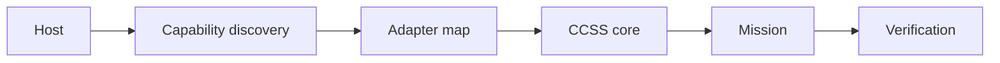
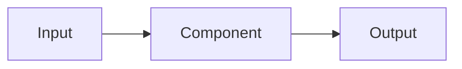

# Architecture Record

**Purpose.** Describe a system’s components, boundaries, interfaces, data flow, risks, and implementation path.

**When to use.** Use before building a multi-component system or when integrations, security, or failure behavior matter.

## Completed example

### Objective and requirements
Keep CCSS portable while allowing host-specific adapters and optional tools.

### Components and interfaces
The host exposes capabilities; adapters normalize them; CCSS plans missions; records preserve state.

### Security and failure modes
Untrusted content cannot grant authority. Missing tools become `DEGRADED` or `UNAVAILABLE`; consequential actions require authorization.

### Tradeoff
Portability is favored over vendor-specific convenience.

## Copy-ready template

### Objective
[System objective]

### Requirements
- Functional: [requirements]
- Non-functional: [security, performance, maintainability]

### Constraints
[Platforms, permissions, budget, deadlines, interoperability]

### Components
| Component | Responsibility | Interface | Owner |
|---|---|---|---|
| [name] | [role] | [inputs/outputs] | [owner] |

### Interfaces and data flow

### Dependencies
[Required systems, versions, or external services]

### Security and permissions
[Trust boundaries, secret handling, operation classes]

### Scalability
[Expected load and scaling strategy]

### Failure modes and recovery
[Failure → diagnosis → recovery → verification]

### Alternatives and tradeoffs
[Options considered and rationale]

### Implementation plan
[Ordered milestones]

### Verification
[Tests, inspections, acceptance checks]
